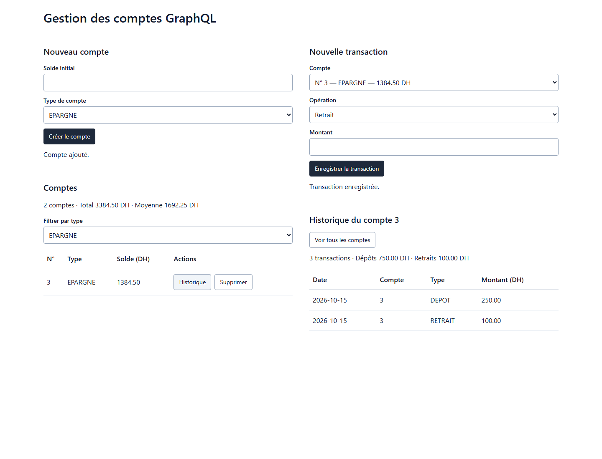

# TP16 — React et Apollo GraphQL

Interface React avec Apollo Client et Tailwind CSS pour gérer les comptes, les dépôts et les retraits. Les listes, soldes et statistiques sont rechargés après chaque mutation. On peut filtrer les comptes par type et consulter l’historique d’un compte.

Démarrer le [serveur GraphQL du TP15](https://github.com/imranelak1/microservices-tp15-graphql) sur le port 19015, puis :

```bash
npm ci
# Copier .env.example vers .env.local
npm start
npm test -- --runInBand
npm run build
```

L’interface est disponible sur `http://localhost:13016`. Le proxy de développement transmet `/graphql` au serveur. Pour un autre serveur, modifier `REACT_APP_GRAPHQL_URL`.

Les erreurs GraphQL restent affichées dans les formulaires. Les captures montrent de vrais comptes et transactions enregistrés par l’API.


